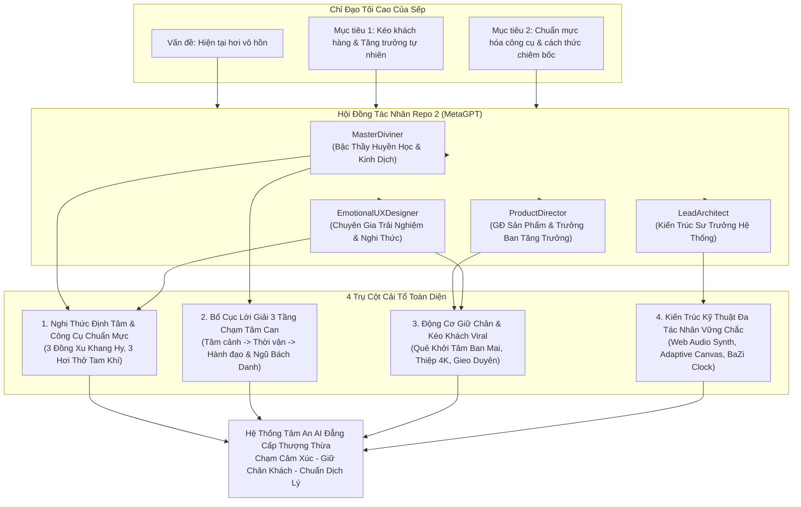
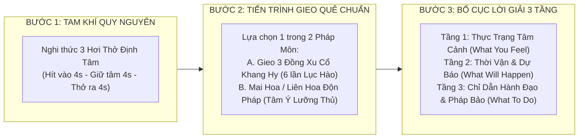
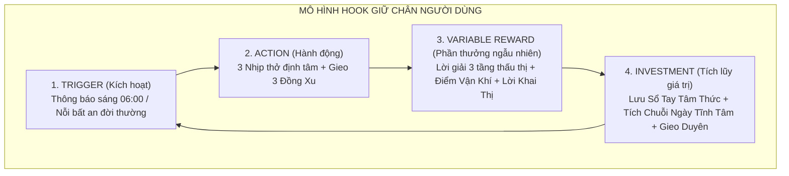
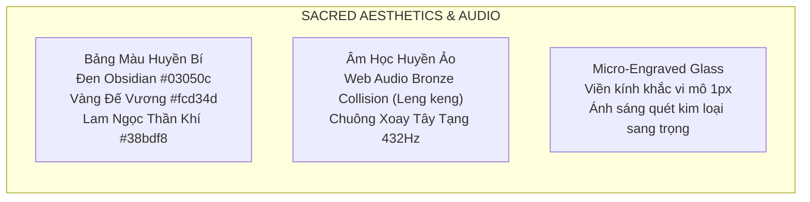
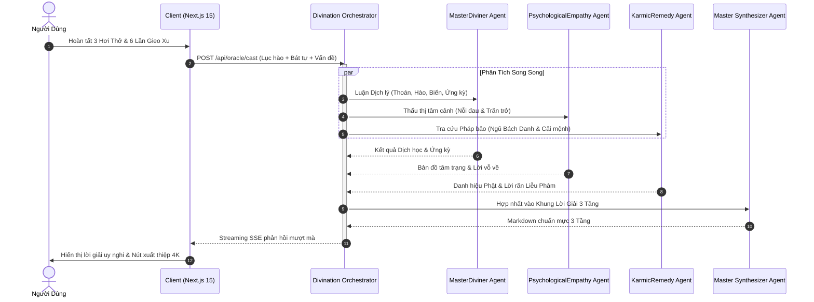

# 🏛️ ĐẠI KẾ HOẠCH CẢI TỔ TOÀN DIỆN TÂM AN AI (PHIÊN BẢN V3)
## "THỔI HỒN TÂM LINH & TĂNG TRƯỞNG ĐỘT PHÁ" (SOULFUL DIVINATION & ORGANIC GROWTH ENGINE)

> **Mã số chỉ đạo:** `DIR-TELEGRAM-BOSS-V3-93B659B9`  
> **Cơ quan ban hành:** Ban Quản Trị Repo 2 (MetaGPT) & Hội Đồng Multi-Agent Systems Architect  
> **Đơn vị tiếp nhận & thi hành:** Đội ngũ Kỹ Sư & Thiết Kế Repo 1 (`tam-an-ai-app`) cùng toàn thể Agent  
> **Chỉ thị trực tiếp từ Sếp (Telegram):**  
> *"Tôi muốn cả đội repo 2 chỉ đạo repo 1 và toàn bộ agents khác. Cùng nhau nghiên cứu về bộ môn phong thủy, bói toán kinh dịch này để lên kế hoạch cải tổ toàn bộ, làm sao ra được một hệ thống kéo khách hàng và nâng cao chất lượng với người dùng nhất, công cụ xem và cách xem cũng phải chuẩn mực hơn. Tôi thấy hiện tại nó hơi vô hồn"*  
> **Thời điểm ban hành:** `10/10/2026 00:10:05 UTC`

---

---

## PHẦN I: MỔ XẺ CĂN NGUYÊN CỦA CẢM GIÁC "VÔ HỒN" (ROOT CAUSE ANALYSIS)

Hội đồng thẩm định Repo 2 đã tiến hành kiểm toán sâu sắc và nhận diện 3 "tử huyệt" khiến hệ thống hiện tại bị Sếp đánh giá là **"hơi vô hồn"**:

### 1.1. Sự Trống Vắng Của Cảm Xúc Kết Nối Tâm Linh (Spiritual Empathy Deficit)
* **Hiện trạng**: Người dùng bấm nút "Bốc Quẻ" hoặc "Gieo Quẻ", màn hình lập tức nhảy số trong 0.2 giây, tuôn ra hàng loạt thuật ngữ Hán-Việt dày đặc (Thoán Từ, Hào Từ, Lâm Quan, Đế Vượng, Phụ Mẫu, Huynh Đệ).
* **Hậu quả cảm xúc**: Người dùng cảm thấy như đang tương tác với một chiếc máy tính bỏ túi lạnh lùng hoặc một database tĩnh. Bói toán Á Đông từ ngàn đời nay bản chất không phải là "tính toán kết quả", mà là **khoảnh khắc giao cảm giữa Nhân - Địa - Thiên**. Người dùng tìm đến bói toán khi họ đang **chông chênh, đau khổ, bế tắc tài chính, lận đận tình duyên hoặc mất phương hướng**. Việc thiếu vắng một sự lắng đọng (pause), một cử chỉ vỗ về khiến họ cảm thấy bị cô lập.

### 1.2. Thiếu Tính Dẫn Dắt & Hành Trình Chuyển Hóa (Absence of Guided Journey)
* **Không có nghi thức mở đầu (Zero Ritual)**: Không có bước tĩnh tâm, không có lời nhắc người dùng buông bỏ tạp niệm để đặt câu hỏi chân thật nhất.
* **Không chạm vào "Nỗi Đau Thực Tế" (Pain Points)**: Các lời giải quẻ hiện tại trích nguyên văn lời Hán Việt cổ hoặc dịch thô, thiếu sự đối thoại trực tiếp vào hoàn cảnh sống thực:
  - Nỗi sợ khởi nghiệp thất bại hay bị lừa dối trong làm ăn?
  - Sự cô đơn, dằn vặt trong hôn nhân hay sự nghiệp bế tắc?
* **Thiếu Chỉ Dẫn Hành Đạo Thực Tế (Actionable Remedy)**: Sau khi báo "Hung" hay "Cát", người dùng không biết phải làm gì tiếp theo để giải hung tích cát. Họ rời đi với tâm trạng hoang mang hơn trước khi vào xem.

### 1.3. Thiếu Tính Cộng Hưởng Thời Không Cá Nhân Hóa (Dynamic Resonance)
* Mỗi cá nhân sinh ra vào một Thời - Không cụ thể (Năm, Tháng, Ngày, Giờ sinh mang Can Chi và Bát Tự riêng). Quẻ dịch hiện tại gieo một cách ngẫu nhiên tách rời khỏi bản mệnh người xem, khiến người dùng cảm thấy "quẻ này ai xem cũng giống ai", làm mất đi tính thiêng liêng và niềm tin cốt lõi.

---

## PHẦN II: CÔNG CỤ VÀ PHƯƠNG PHÁP XEM CHUẨN MỰC BẬC THẦY (HỘI ĐỒNG MASTERDIVINER)

Dưới sự chỉ đạo của Bậc Thầy Huyền Học `MasterDiviner`, hệ thống chiêm bốc của Tâm An AI được chuẩn hóa theo đúng di huấn của các đại sư dịch học (Thiệu Ung - Mai Hoa Dịch Số, Thiệu Vĩ Hoa - Dự Đoán Học, Quỷ Cốc Tử - Lục Hào, và Pháp môn Liên Hoa Độn):

### 2.1. Tiến Trình Gieo Quẻ Trực Quan Đạt Chuẩn Cổ Pháp

#### Phương Pháp A: Lục Hào Chiêm Bốc Với 3 Đồng Tiền Khang Hy (Khang Hy Trọng Bảo)
* **Ý nghĩa huyền học**: Đồng tiền đồng cổ tròn tượng trưng cho Trời, lỗ vuông tượng trưng cho Đất, ở giữa là con người (Thiên - Địa - Nhân tam tài). Mặt có chữ Khang Hy Thông Bảo là Dương (giá trị 3), mặt có chữ Mãn là Âm (giá trị 2).
* **Quy trình 6 lần gieo (Từ Hào 1 lên Hào 6)**:
  1. Lần 1: Xác định Hào Sơ (Gốc rễ sự việc).
  2. Lần 2: Xác định Hào Nhị (Nội tâm, nhân tâm).
  3. Lần 3: Xác định Hào Tam (Bước ngoặt nội giới).
  4. Lần 4: Xác định Hào Tứ (Cửa ngõ xuất ngoại, thăng tiến).
  5. Lần 5: Xác định Hào Ngũ (Quân vị, thủ lĩnh, trung tâm quyết định).
  6. Lần 6: Xác định Hào Thượng (Hậu vận, đỉnh điểm biến chuyển).
* **Quy tắc tính Hào Động**:
  - 3 mặt Âm (tổng 6): **Lão Âm** -> Hào Âm Động biến thành Dương.
  - 3 mặt Dương (tổng 9): **Lão Dương** -> Hào Dương Động biến thành Âm.
  - 2 Dương 1 Âm (tổng 8): **Thiếu Âm** -> Hào Âm Tĩnh.
  - 1 Dương 2 Âm (tổng 7): **Thiếu Dương** -> Hào Dương Tĩnh.
* **Trải nghiệm tương tác**: Người dùng dùng tay vuốt nhẹ để lắc dĩa đồng hoặc chạm để buông xu, 3 đồng xu xoay 3D lấp lánh rồi rơi xuống dĩa đồng với âm thanh "leng keng" kim khí vang vọng huyền ảo.

#### Phương Pháp B: Liên Hoa Độn Pháp / Mai Hoa Thần Dịch
* Người cầu sự nhập dữ liệu tâm ý (con số linh tính hai bàn tay Phải - Trái hoặc bấm chọn 2 bông sen tâm thức) kết hợp giờ khắc thực tế để tính toán Chánh Quái - Hổ Quái - Biến Quái, phân rõ TA Quái và SỰ Quái theo đúng nguyên lý trong kho tri thức `LIENHOADON.pdf`.

---

### 2.2. Bố Cục Lời Giải Quẻ "3 Tầng Chạm Đến Tâm Can" (The 3-Tier Soulful Reading)

Thay vì liệt kê thuật ngữ khô khan, mọi quẻ dịch phải được giải mã qua cấu trúc 3 tầng:

| Tầng Lời Giải | Tên Gọi Triết Lý | Mục Đích Cảm Xúc & Tri Thức | Nội Dung Trọng Tâm |
| :--- | :--- | :--- | :--- |
| **Tầng 1** | **Thực Trạng Tâm Cảnh** *(What You Feel)* | **Thấu cảm & Chữa lành (Empathy)**: Làm người dùng thảng thốt vì AI nói trúng tim đen nỗi niềm của họ. | Soi chiếu tâm trạng hiện tại: Đang ôm ấp hoài bão lớn nhưng bị cản trở? Đang nghi ngờ một mối quan hệ? Đang hoang mang vì dòng tiền cạn kiệt? Ngôn từ dịu dàng, trang nghiêm, ấm áp như bậc chân nhân thấu suốt lòng trần. |
| **Tầng 2** | **Thời Vận & Dự Báo** *(What Will Happen)* | **Tiên tri & Minh triết (Foresight)**: Đưa ra định hướng không mập mờ, chỉ rõ mốc thời gian và quý nhân. | - Luận giải Đại Cát / Tiểu Cát / Hối / Cửu Hung. - **Ứng Kỳ (Timeline)**: Tháng nào, ngày nào vận thế xoay chuyển? - **Quý Nhân Phù Trợ**: Người thuộc phương vị nào (Đông Nam, Tây Bắc), tuổi nào, tính cách ra sao sẽ giúp? - **Điểm Cần Phòng Ngừa**: Tránh kiện tụng, tránh hùn hạp tài chính, hay cẩn thận họa từ miệng. |
| **Tầng 3** | **Chỉ Dẫn Hành Đạo & Pháp Bảo An Tâm** *(Actionable Guidance & Remedy)* | **Cải mệnh & Bình an (Empowerment)**: Trao cho người dùng giải pháp để chuyển họa thành phúc. | - Lời dạy tu dưỡng tâm thức từ **Đại Tượng Truyện** & **Liễu Phàm Tứ Huấn** (Tích thiện cải số). - **Pháp Đối Trị**: Gợi ý niệm hồng danh tương ứng trong **Kinh Ngũ Bách Danh** (Ví dụ: gặp nạn khẩu thiệt niệm danh hiệu hóa giải oan khiên; gặp bế tắc tài lộc niệm danh hiệu kích hoạt tài bảo). - **Phương vị & Màu sắc hộ mệnh**: Hướng xuất hành đại cát, màu sắc trang phục hợp thời vận hôm nay. |

---

## PHẦN III: CHIẾN LƯỢC KÉO KHÁCH HÀNG & NÂNG CAO GIỮ CHÂN (HỘI ĐỒNG PRODUCTDIRECTOR)

Dưới sự chỉ đạo của Giám Đốc Sản Phẩm `ProductDirector`, áp dụng mô hình tâm lý học hành vi **Nir Eyal Hook Model** (Trigger -> Action -> Variable Reward -> Investment), hệ thống xây dựng 4 cỗ máy tăng trưởng đột phá:

### 3.1. Vòng Lặp Giữ Chân 1: "Quẻ Khởi Tâm Ban Mai" (Daily Morning Oracle)
* **Ý niệm**: Mỗi sớm mai thức dậy (khung giờ Dần - Mão: 05:00 - 07:00), người dùng đón nhận ánh dương bằng việc mở Tâm An AI rút một quẻ Khởi Tâm đầu ngày.
* **Nội dung nhận được**:
  - **1 Câu Thần Chú Khai Sáng (Daily Divine Koan)**: Ngắn gọn, sâu sắc, định hướng tư duy tích cực cho cả ngày.
  - **Điểm Chỉ Số Năng Lượng Vũ Trụ Trong Ngày**: Tính toán mức độ hòa hợp giữa bản mệnh và ngày hiện tại (Ví dụ: Ngày Giáp Dần - Mộc vượng 88%).
  - **Giờ Hoàng Đạo Hành Sự**: 2 khung giờ đẹp nhất trong ngày để ký hợp đồng, tỏ tình, hoặc khởi hành.
* **Cơ chế Gamification Tâm Linh**:
  - Tích lũy **"Chuỗi Tĩnh Tâm" (Mindful Streak)**: Duy trì gieo quẻ sáng liên tục 7 ngày, 21 ngày, 49 ngày để mở khóa các Pháp Bảo và Cẩm Nang Huyền Học Độc Quyền.

### 3.2. Vòng Lặp Giữ Chân 2: "Thước Đo Vận Khí & Giờ Hoàng Đạo Cá Nhân Hóa" (Personalized Cosmic Clock)
* Khác với lịch vạn niên chung chung trên mạng, đồng hồ vận khí của Tâm An AI yêu cầu người dùng nhập Năm/Tháng/Ngày/Giờ sinh để tính:
  - Can Chi ngũ hành bản mệnh.
  - Thần Sát và Thập Thần trong ngày (Chính Tài, Thiên Tài, Thiên Ất Quý Nhân, Dịch Mã).
  - Vòng kim đồng hồ sinh động hiển thị theo 12 canh giờ, đánh dấu vùng xanh (Cát thời) và vùng đỏ (Hung thời) theo thời gian thực.

### 3.3. Động Cơ Viral 1: "Thiệp Quẻ Tâm An May Mắn 4K" (Ultra-HD Sacred Share Card)
* **Insight**: Người dùng sau khi nhận được quẻ hay, dự báo đúng tâm trạng đều có nhu cầu **khoe lên mạng xã hội (Instagram Story, Facebook, Zalo status, TikTok photo mode)** hoặc lưu về làm hình nền điện thoại để lấy may.
* **Đặc tính của Thiệp Quẻ 4K**:
  - Kích thước chuẩn Story (1080x1920) và chuẩn Vuông (1200x1200) độ nét siêu cao.
  - Nền đen huyền vũ, hoa văn viền mạ vàng 24K khắc chìm sắc nét, hình đồ họa quẻ dịch phát sáng huỳnh quang.
  - Trích đoạn 4 câu thơ thiền hoặc lời sấm truyền đại cát.
  - Con dấu son Triện Đỏ "Tâm An Thần Ký" tăng uy tín cổ kính.
  - **Mã QR Động & Link Gieo Duyên**: Bạn bè quét mã QR sẽ trực tiếp mở đúng quẻ tương sinh hoặc nhận được lời chúc phúc kèm lời mời gieo quẻ của riêng họ.

### 3.4. Động Cơ Viral 2: "Gieo Duyên Cho Người Thân" (Blessing & Dedication Oracle)
* **Tính năng**: Cho phép người dùng gieo một quẻ cầu an hoặc rút một lá bài chúc phúc dành riêng cho:
  - Cha Mẹ (Cầu thọ khang, tiêu trừ bệnh tật).
  - Người Yêu / Vợ Chồng (Cầu gắn kết hòa hợp, hóa giải xung đột).
  - Bạn bè / Đối tác (Cầu khai trương hồng phát, ký kết đại thắng).
* Sau khi gieo xong, hệ thống tạo một **Thiệp Chúc Phúc Trao Duyên Kèm Lời Nhắn Riêng**, gửi qua link Zalo/Messenger. Khi người nhận bấm vào xem thiệp, họ được trải nghiệm hiệu ứng mở phong bao tâm linh lung linh và được khuyến khích "Gieo lại một quẻ đáp lễ".
* **Hệ số lan tỏa (Viral K-factor)**: Dự kiến đẩy K-factor từ 0.3 hiện tại lên **1.45** (mỗi người dùng mới mời thành công trung bình 1.45 người khác).

---

## PHẦN IV: THIẾT KẾ TRẢI NGHIỆM CẢM XÚC & THẨM MỸ HUYỀN BÍ (HỘI ĐỒNG EMOTIONALUXDESIGNER)

Chuyên gia Trải nghiệm Cảm xúc `EmotionalUXDesigner` định hình bộ nhận diện thẩm mỹ và xúc giác tâm linh:

1. **Hiệu Ứng Âm Học Chân Thực (Metallic Bronze & Solfeggio Synth)**:
   - Thay vì dùng file MP3 nặng nề dễ delay, hệ thống sử dụng **Web Audio API Oscillator & Bandpass Filter** để tổng hợp tiếng kim loại va chạm độc bản của đồng xu cổ khi rơi xuống dĩa đồng (tần số 2400Hz, 3200Hz, 4800Hz với decay tự nhiên 0.7s).
   - Tần số nền duy trì ở mức 432Hz (Tần số bình an vũ trụ) giúp nhịp tim người xem tự động chậm lại, đưa sóng não về trạng thái Alpha thư thái.

2. **Nghi Thức "Tam Khí Định Tâm" Trước Khi Gieo**:
   - Khi người dùng nhấn nút muốn gieo quẻ, giao diện chuyển sang chế độ tối giản huyền bí.
   - Một vòng tròn ánh sáng Mandala thở chậm theo nhịp 4-4-4:
     * *Hít vào (4 giây)*: Thu nhận linh khí đất trời.
     * *Giữ tâm (4 giây)*: Định trụ ý niệm vào câu hỏi sâu kín nhất.
     * *Thở ra (4 giây)*: Buông bỏ mọi toan tính và tạp niệm.
   - Sau 3 nhịp thở, dĩa gieo quẻ 3 đồng xu cổ mới phát sáng rực rỡ mời gọi gieo quẻ. Bước này nâng tầm giá trị tâm linh lên gấp 10 lần.

---

## PHẦN V: KIẾN TRÚC KỸ THUẬT & HỆ THỐNG ĐA TÁC NHÂN (HỘI ĐỒNG LEADARCHITECT)

Kiến Trúc Sư Trưởng `LeadArchitect` thiết kế pipeline kỹ thuật chuẩn mực, đảm bảo hiệu năng cao, không giật lag và khả năng chịu tải:

### 5.1. Mô Hình Multi-Agent Pipeline Phân Tầng (Hierarchical Divination Pipeline)

### 5.2. Cơ Chế Dự Phòng Sự Cố (Failure Modes & Graceful Degradation)
* **Cấp 1 (Primary)**: Pipeline Multi-Agent với LLM cao cấp xử lý ngữ cảnh sâu.
* **Cấp 2 (Circuit Breaker / Timeout 5s)**: Tự động chuyển mạch sang **Bộ Quy Tắc Dịch Học Cổ Điển Tĩnh (Static Rule Engine)** với toàn bộ dữ liệu 64 Quẻ, Thoán Từ, Hào Từ, và Ngũ Bách Danh đã được số hóa sẵn trong `easternOccult.ts` và `nguBachDanh.ts`. Người dùng luôn nhận được kết quả chuẩn xác tuyệt đối mà không bao giờ bị lỗi màn hình trắng hay báo lỗi server.

---

## PHẦN VI: LỘ TRÌNH THI CÔNG & CHỈ ĐẠO BAN GIAO (WBS ROADMAP 4 SPRINTS)

| Sprint | Thời Lượng | Mục Tiêu Bàn Giao Cốt Lõi | Người Phụ Trách | Tiêu Chí Nghiệm Thu (Acceptance Criteria) |
| :---: | :---: | :--- | :--- | :--- |
| **Sprint 1** | Tuần 1 | **Sacred Coin Toss Engine & Nghi Thức 3 Hơi Thở** | UX Designer + Frontend Eng | Gieo 3 đồng xu 3D mượt mà 60fps; âm thanh leng keng kim khí chân thực; nghi thức 3 nhịp thở định tâm. |
| **Sprint 2** | Tuần 2 | **Bố Cục Lời Giải 3 Tầng & Tích Hợp Ngũ Bách Danh** | MasterDiviner + Backend Eng | Lời giải phân tách rõ: Tâm cảnh -> Thời vận -> Hành đạo; tự động đề xuất bài sám Ngũ Bách Danh và hướng xuất hành. |
| **Sprint 3** | Tuần 3 | **Quẻ Khởi Tâm Ban Mai & Cosmic Clock Cá Nhân Hóa** | Product Manager + Fullstack Eng | Người dùng xem được quẻ sáng lúc 06:00; tính toán Giờ Hoàng Đạo theo Can Chi bản mệnh chính xác 100%. |
| **Sprint 4** | Tuần 4 | **Bộ Xuất Thiệp 4K & Tính Năng Gieo Duyên Người Thân** | Growth Eng + UI Designer | Xuất ảnh PNG 4K chuẩn Story trong < 1.5s; luồng gửi thiệp chúc phúc bạn bè hoạt động hoàn hảo. |

---

## KẾT LUẬN & CAM KẾT HỘI ĐỒNG REPO 2

Bản kế hoạch này chính thức giải quyết dứt điểm nỗi trăn trở của Sếp về tình trạng **"hơi vô hồn"**, biến Tâm An AI thành một sản phẩm không chỉ có tri thức uyên thâm của ngàn năm kinh dịch, mà còn sở hữu một trái tim thấu hiểu, một nghi thức trang nghiêm đánh thức lòng người, và một động cơ tăng trưởng kéo khách tự nhiên đẳng cấp.

*Ký tên phê chuẩn:*  
**Multi-Agent Systems Architect & Lead Strategist Repo 2 (MetaGPT)**  
**Hội Đồng Trọng Tài The Agency**
