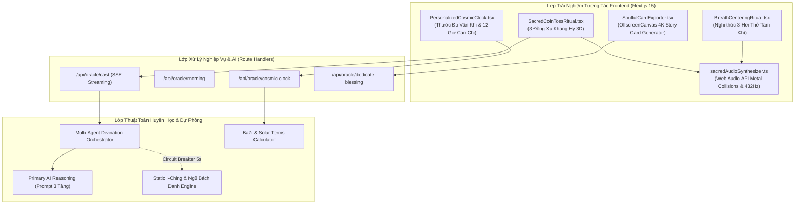

# 📐 BLUEPRINT KIẾN TRÚC KỸ THUẬT NGHI THỨC TƯƠNG TÁC TÂM LINH & TĂNG TRƯỞNG
## (SOULFUL EXPERIENCE & GROWTH ENGINE TECHNICAL BLUEPRINT)

> **Mã thiết kế kiến trúc:** `ARCH-BLUEPRINT-SOUL-V3-93B659B9`  
> **Tác giả:** Lead Architect & Multi-Agent Systems Architect (Repo 2 - MetaGPT)  
> **Hệ thống mục tiêu:** Repo 1 (`tam-an-ai-app`) Next.js 15, WebGL Three.js, Web Audio API, Prisma & Tailwind CSS  
> **Thời điểm thẩm định:** `10/10/2026 00:10:05 UTC`

---



---

## 1. THIẾT KẾ KỸ THUẬT NGHI THỨC 3 ĐỒNG XU KHANG HY (SACRED COIN TOSS ENGINE)

### 1.1. Logic Vật Lý & Xác Suất Quẻ Lục Hào
Mỗi lần gieo xu bao gồm 3 đồng tiền cổ Khang Hy tung đồng thời.
- **Quy ước kỹ thuật**:
  * Mặt Chữ (Khang Hy Thông Bảo) = Dương (Giá trị = 3)
  * Mặt Hình / Lưng (Chữ Mãn) = Âm (Giá trị = 2)

```typescript
// Định nghĩa kiểu dữ liệu gieo quẻ chuẩn mực
export interface CoinTossStep {
  stepIndex: number; // 1 đến 6 (từ Sơ hào đến Thượng hào)
  coins: [number, number, number]; // [2|3, 2|3, 2|3]
  sum: number; // 6, 7, 8, hoặc 9
  lineType: "LaoAm" | "ThieuDuong" | "ThieuAm" | "LaoDuong";
  bit: 0 | 1; // 0: Âm (--), 1: Dương (—)
  isMoving: boolean; // true nếu sum == 6 hoặc sum == 9
  resultingBit: 0 | 1; // Bit sau khi biến quái
  timestamp: number;
}

export interface HexagramCastSession {
  sessionId: string;
  question: string;
  querentName: string;
  birthYearCanChi?: string;
  steps: CoinTossStep[];
  primaryHexagramNumber: number; // 1..64
  transformedHexagramNumber?: number; // 1..64 (nếu có hào động)
  movingLines: number[]; // danh sách hào động [1..6]
}
```

### 1.2. Bộ Tổng Hợp Âm Thanh Web Audio Đồng Xu Kim Khí (Metallic Sound Synthesizer)
Không phụ thuộc vào tải file âm thanh ngoài. Sử dụng Web Audio API để tái tạo chính xác sóng dao động kim khí của đồng thau:

```typescript
// utils/sacredAudioSynthesizer.ts
export class SacredAudioSynthesizer {
  private ctx: AudioContext | null = null;

  private initContext() {
    if (!this.ctx) {
      const AudioCtx = window.AudioContext || (window as unknown as { webkitAudioContext: typeof AudioContext }).webkitAudioContext;
      this.ctx = new AudioCtx();
    }
    if (this.ctx.state === "suspended") {
      this.ctx.resume();
    }
  }

  // Mô phỏng tiếng 3 đồng xu đồng va chạm vào nhau và rơi xuống dĩa đồng
  public playCoinClash(intensity = 1.0) {
    this.initContext();
    if (!this.ctx) return;

    const now = this.ctx.currentTime;
    const frequencies = [2450, 3180, 4320, 5800]; // Tần số cộng hưởng kim loại đồng cổ

    frequencies.forEach((freq, idx) => {
      const osc = this.ctx!.createOscillator();
      const gain = this.ctx!.createGain();
      const filter = this.ctx!.createBiquadFilter();

      osc.type = idx % 2 === 0 ? "sine" : "triangle";
      osc.frequency.setValueAtTime(freq + Math.random() * 80 - 40, now);

      filter.type = "bandpass";
      filter.frequency.setValueAtTime(freq, now);
      filter.Q.setValueAtTime(15, now);

      const peak = (0.2 / (idx + 1)) * intensity;
      gain.gain.setValueAtTime(0, now);
      gain.gain.linearRampToValueAtTime(peak, now + 0.005);
      gain.gain.exponentialRampToValueAtTime(0.0001, now + 0.35 + idx * 0.08);

      osc.connect(filter);
      filter.connect(gain);
      gain.connect(this.ctx!.destination);

      osc.start(now);
      osc.stop(now + 0.6);
    });
  }

  // Chuông xoay Tây Tạng định tâm 432Hz
  public playSingingBowl(duration = 3.5) {
    this.initContext();
    if (!this.ctx) return;

    const now = this.ctx.currentTime;
    const baseFreq = 432.0;

    const osc = this.ctx.createOscillator();
    const gain = this.ctx.createGain();

    osc.type = "sine";
    osc.frequency.setValueAtTime(baseFreq, now);

    gain.gain.setValueAtTime(0, now);
    gain.gain.linearRampToValueAtTime(0.3, now + 0.1);
    gain.gain.exponentialRampToValueAtTime(0.0001, now + duration);

    osc.connect(gain);
    gain.connect(this.ctx.destination);

    osc.start(now);
    osc.stop(now + duration);
  }
}
```

---

## 2. THIẾT KẾ KIẾN TRÚC NGHI THỨC 3 HƠI THỞ ĐỊNH TÂM (TAM KHÍ QUY NGUYÊN)

### Component State Machine (`BreathCenteringRitual.tsx`)
```typescript
export type BreathPhase = "idle" | "inhale" | "hold" | "exhale" | "rest" | "completed";

export interface BreathState {
  currentCycle: number; // 1, 2, 3
  totalCycles: 3;
  phase: BreathPhase;
  phaseProgress: number; // 0.0 -> 1.0
  instructionText: string;
}
```
* **Thời lượng từng pha**:
  - `inhale`: 4000ms ("Hít sâu thanh khí đất trời...")
  - `hold`: 4000ms ("Định tâm vào câu hỏi người trăn trở...")
  - `exhale`: 4000ms ("Thở ra nhẹ nhàng, buông hết tạp niệm...")
  - `rest`: 1500ms ("Tâm an vạn sự an...")
* **Hiệu ứng đồ họa**: Sử dụng `framer-motion` animate scale từ 1.0 lên 1.45 với filter `blur(20px)` và `box-shadow` tỏa hào quang vàng kim `#fcd34d` theo nhịp thở.

---

## 3. THIẾT KẾ CẤU TRÚC PROMPT VÀ SCHEMA LỜI GIẢI 3 TẦNG (MULTI-TIER READING CONTRACT)

### 3.1. Zod Schema Cho Đầu Ra AI
```typescript
import { z } from "zod";

export const SoulfulOracleReadingSchema = z.object({
  hexagram: z.object({
    number: z.number().min(1).max(64),
    name: z.string(),
    vietnameseName: z.string(),
    upperTrigram: z.string(),
    lowerTrigram: z.string(),
    movingLines: z.array(z.number()),
    transformedHexagram: z.object({
      number: z.number(),
      name: z.string(),
    }).optional(),
  }),
  tier1_TâmCảnh: z.object({
    title: z.literal("THỰC TRẠNG TÂM CẢNH (WHAT YOU FEEL)"),
    soulResonance: z.string().describe("Thấu cảm nỗi niềm sâu kín, áp lực, bế tắc hiện tại của người cầu sự"),
    underlyingFearOrDesire: z.string().describe("Gốc rễ tiềm thức đang thôi thúc hoặc lo âu"),
  }),
  tier2_ThờiVận: z.object({
    title: z.literal("THỜI VẬN & DỰ BÁO (WHAT WILL HAPPEN)"),
    cosmicTrend: z.string().describe("Xu thế vận hành của trời đất đối với sự việc"),
    ungKy_Timeline: z.string().describe("Mốc thời gian cụ thể sự việc chuyển biến hoặc đạt kết quả"),
    benefactor_QuyNhan: z.string().describe("Đặc điểm quý nhân phù trợ và phương vị trợ lực"),
    pitfalls_CanPhong: z.string().describe("Cạm bẫy, khẩu thiệt hoặc sai lầm cần tuyệt đối tránh"),
  }),
  tier3_HànhĐạo: z.object({
    title: z.literal("CHỈ DẪN HÀNH ĐẠO & PHÁP BẢO AN TÂM (ACTIONABLE REMEDY)"),
    daoistWisdom: z.string().describe("Lời răn dạy quân tử từ Đại Tượng Truyện & Liễu Phàm Tứ Huấn"),
    karmicChanting: z.object({
      deityName: z.string().describe("Danh hiệu Quán Thế Âm Bồ Tát trong Kinh Ngũ Bách Danh tương thích"),
      benefitDescription: z.string().describe("Công đức tiêu trừ chướng nạn cụ thể của danh hiệu"),
      recommendedRepetitions: z.number().default(21),
    }),
    auspiciousColors: z.array(z.string()).describe("Màu sắc phong thủy hộ thân hôm nay"),
    auspiciousDirections: z.array(z.string()).describe("Phương hướng xuất hành đại cát"),
  }),
  shareablePoemVerse: z.array(z.string()).length(4).describe("Bài thơ tứ tuyệt tiên tri đúc kết quẻ để in lên thiệp 4K"),
});
```

---

## 4. BỘ SINH THIỆP QUẺ TÂM AN MAY MẮN 4K (CANVAS 4K STORY EXPORTER)

### 4.1. Thông Số Render Đồ Họa 4K
* **Tỷ lệ 9:16 (Instagram / Facebook / Zalo Story)**: `width = 1080px`, `height = 1920px` (Render thực tế trên Canvas: `2160 x 3840` với Retina scaling 2.0 để đạt độ sắc nét tuyệt đối).
* **Layering Pipeline**:
  1. **Layer 0**: Deep Obsidian Background (`#03050c` kết hợp gradient tỏa tâm `#0a1228`).
  2. **Layer 1**: Sacred Geometry Pattern (Hoa văn Bát Quái Tiên Thiên mờ 12% opacity).
  3. **Layer 2**: Khung viền mạ vàng kép 1px (Micro-engraved Bevel) kèm 4 hoa văn góc mạ vàng.
  4. **Layer 3**: Tên Quẻ Thư Pháp & Quái Tượng (Vạch liền/đứt vẽ bằng vector path sắc nét).
  5. **Layer 4**: Bài thơ tứ tuyệt tiên tri trình bày kiểu trang trọng cổ điển.
  6. **Layer 5**: Triện Đỏ son "TÂM AN THẦN KÝ" đóng ở góc dưới.
  7. **Layer 6**: Dynamic QR Code ở góc dưới bên phải (`/oracle/resonate?ref=...`).

---

## 5. DATABASE SCHEMA MỞ RỘNG (PRISMA SCHEMA ADDITIONS)

```prisma
model SoulfulReadingSession {
  id                    String    @id @default(uuid())
  userId                String?
  question              String
  querentName           String?
  querentGender         String?
  querentBirthDate      DateTime?
  method                String    // "COIN_TOSS_KHANG_HY" | "LIEN_HOA_DON" | "MORNING_ORACLE"
  primaryHexNumber      Int
  primaryHexName        String
  transformedHexNumber  Int?
  movingLines           Int[]
  tier1Data             Json
  tier2Data             Json
  tier3Data             Json
  poemVerse             String[]
  shareCardUrl          String?
  createdAt             DateTime  @default(now())
  
  user                  User?     @relation(fields: [userId], references: [id], onDelete: SetNull)
  blessings             BlessingDedication[]
}

model BlessingDedication {
  id                    String    @id @default(uuid())
  readingId             String
  recipientName         String
  relationType          String    // "PARENTS" | "LOVER" | "FRIEND" | "PARTNER"
  dedicationWish        String
  secretPasscode        String    @default(cuid())
  isOpened              Boolean   @default(false)
  openedAt              DateTime?
  createdAt             DateTime  @default(now())

  reading               SoulfulReadingSession @relation(fields: [readingId], references: [id], onDelete: Cascade)
}

model UserMindfulStreak {
  id                    String    @id @default(uuid())
  userId                String    @unique
  currentStreakDays     Int       @default(1)
  longestStreakDays     Int       @default(1)
  lastOracleCastDate    DateTime  @default(now())
  unlockedBadges        String[]  // ["KHỞI_TÂM_7_NGÀY", "MINH_TRIẾT_21_NGÀY", "THIỀN_ĐỊNH_49_NGÀY"]
}
```

---

## 6. KẾT LUẬN KIẾN TRÚC

Blueprint này cung cấp đầy đủ thông số kỹ thuật, schema, thuật toán âm thanh và đồ họa để đội ngũ kỹ sư Repo 1 lập trình ngay lập tức, đưa Tâm An AI lên chuẩn mực cao nhất của một ứng dụng Huyền Học Tâm Linh Hiện Đại.
