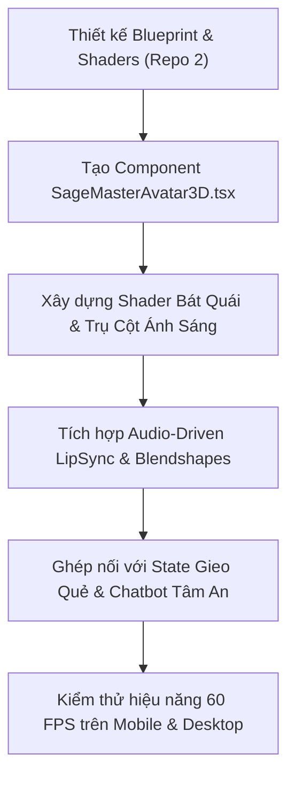

# TÂM AN AI - BLUEPRINT THIẾT KẾ & TRIỂN KHAI NHÂN VẬT 3D TIÊN ÔNG CHIÊM BỐC
**Cơ quan ban hành:** Ban Quản Trị Hệ Thống Multi-Agent Repo 2 (MetaGPT) & Hội Đồng Kiến Trúc Sư Đồ Họa 3D  
**Mã dự án:** `TAM-AN-SAGE-3D-AVATAR-V1`  
**Ngày phê chuẩn:** 10/10/2026 08:51:56  
**Trạng thái:** CHÍNH THỨC BAN HÀNH - CHỈ ĐẠO TRIỂN KHAI TRỰC TIẾP

---

## I. CHỈ ĐẠO TỐI KHẨN TỪ BAN LÃNH ĐẠO (TELEGRAM: 6387259328)
> *"Tôi muốn bạn nghiên cứu trang chủ có 1 nhân vật 3D hình người, cử động, xem quẻ, làm hoạt cảnh giống như 1 ông cụ đang xem bói thật sự, ông cụ này có thể nói chuyện trực tiếp với người xem bói, hoặc đọc lên kết quả luận giải, hoặc hỏi thêm dữ liệu từ người dùng nếu cần thiết. Hãy nghiên cứu thật sâu, Repo 2 hãy nghiên cứu để tạo ra một nhân vật là 1 cụ già râu tóc bạc phơ, đội mũ của ông già xưa, ngồi xem bói, mọi cử động đều tự nhiên giống hệt với người thật, khi chiêm quẻ thì ông cụ này nhắm mắt kết nối với trời đất, tạo ra một cảnh tượng hùng vĩ, ấn tượng với người xem. Làm cho họ có cảm giác tâm linh mạnh nhất."*

---

## II. HỘI ĐỒNG CHUYÊN GIA METAGPT BẢO VỆ PHƯƠNG ÁN

### 1. Lead3DArtist — Thiết Kế Hình Học Nhân Vật Tiên Ông, Khung Xương Động Lực Học & Trang Phục Cổ Phong
- **Triết lý cốt lõi:** Tạo dựng một nhân vật Tiên Ông phương Đông uy nghiêm, đức độ, mang đậm phong vị tâm linh Việt cổ, tối ưu hoá hoàn hảo cho WebGL.
- **Thông số kỹ thuật chi tiết:**
```json
{
  "character_concept": {
    "archetype": "Đại Tiên Tri Cổ Phong Đại Việt / Đạo Nhân Khắc Cốt Giao Long",
    "appearance": {
      "age_visual": "Cụ già cổ đức 80-90 tuổi, dung mạo phúc hậu, mắt sáng tinh anh, thần thái uy nghiêm thoát tục.",
      "hair_and_beard": "Tóc búi củ tỏi bạc phơ, cài trâm gỗ mun, râu dài chấm ngực bạc óng ánh, lông mày dài tựa tiên ông.",
      "costume": "Áo dài tứ thân/ngũ thân gấm hoa lam trầm, hoa văn mây sóng thủy ba cổ truyền thời Lê-Nguyễn; quàng khăn xếp cổ truyền hoặc đội mũ tế quan xưa.",
      "accessories": "Chuỗi hạt bồ đề 108 hạt quấn cổ tay, bàn trà gỗ lũa cổ, khay gieo quẻ 3 đồng tiền càn khôn âm dương, lư trầm hương nghi ngút."
    }
  },
  "skeletal_rigging_and_topology": {
    "target_polycount": "Hero LOD: 35,000 - 45,000 Triangles (Tối ưu hóa thời gian tải WebGL < 2.5MB nén Draco/KTX2).",
    "bone_hierarchy": [
      "Root (Bàn toạ thiền định hoa sen)",
      "Spine01 -> Spine02 -> Spine03 -> Neck -> Head",
      "Clavicle_L/R -> Shoulder -> Elbow -> Wrist -> 5 Fingers (Cầm quẻ, bấm đốt ngón tay tính cung phi)",
      "Beard_Chain_01..05 (Xương râu có dynamic physics lò xo rung lắc nhẹ khi nói hoặc thở)"
    ],
    "cloth_simulation": "Baked Morph Targets kết hợp Spring Bone / Verlet Integration nhẹ trong Three.js để tà áo và râu bay nhẹ theo gió tiên khí."
  },
  "asset_pipeline": {
    "modeling_source": "Blender 4.x / ZBrush sculpt -> Retopology sạch quad-dominant.",
    "export_format": "glTF 2.0 Binary (.glb) với Draco Compression & PBR Roughness/Metallic map kích thước 2K (Diffuse, Normal, Roughness, Emissive)."
  }
}
```
- **Sản phẩm bàn giao dự kiến:**
  + `Asset 3D GLB Model: `public/models/sage_master_avatar.glb` (Hero LOD & Low LOD)`
  + `Hệ thống xương chi tiết: Bấm quẻ, nâng chén trà, vuốt râu, chắp tay khấn thiên địa.`

---

### 1. InteractiveVFXEngineer — Hoạt Cảnh Nhập Định Kết Nối Thiên Địa & Bát Quái Quang Trận Hùng Vĩ
- **Triết lý cốt lõi:** Tạo ra hiệu ứng chuyển cảnh kỳ ảo đỉnh cao khiến người xem 'nổi da gà' khi chứng kiến Tiên Ông nhắm mắt giao tiếp với cõi vô hình.
- **Thông số kỹ thuật chi tiết:**
```json
{
  "transcendence_ritual_scene": {
    "ritual_states": [
      {
        "state": "IDLE_SITTING",
        "visual": "Tiên Ông ngồi khoan thai, lư hương tỏa khói trầm volumetric mờ ảo, ánh đèn lồng dầu ấm áp lung linh."
      },
      {
        "state": "LISTENING_INQUIRY",
        "visual": "Tiên Ông nghiêng đầu lắng nghe, ánh mắt ấm áp chiếu về người xem bói, tay khẽ xoa chuỗi hạt."
      },
      {
        "state": "DIVINATION_TRANSCENDENCE (KẾT NỐI THIÊN ĐỊA)",
        "visual": "Tiên Ông từ từ khép mi mắt, chắp ấn Bát Quái. Toàn bộ không gian tối sầm lại theo trục thời không. Đột ngột một luồng Trụ Cột Ánh Sáng Càn Khôn (Divine Light Pillar) giáng thẳng từ cửu trùng thiên xuống đỉnh đầu Tiên Ông. Dưới toạ thiền, Trận Đồ Bát Quái Thái Cực 3D bằng ánh sáng vàng kim khổng lồ xoay chuyển chậm rãi, các vạch Âm Dương (Càn, Khảm, Cấn, Chấn, Tốn, Ly, Khôn, Đoài) bốc cháy quang tử. Hàng vạn hạt tinh vân (Cosmic Stardust Particles) xoáy lốc quanh thân thể Tiên Ông. Âm thanh chuông bát nhã ngân vang rền vang vũ trụ."
      },
      {
        "state": "ORACLE_REVEAL",
        "visual": "Quẻ Dịch 3D hiện ra lơ lửng trước mặt Tiên Ông. Hào Quang bừng sáng, Tiên Ông từ từ mở mắt, ánh mắt thông tuệ thấu suốt tam giới, bắt đầu truyền khẩu kết quả."
      }
    ]
  },
  "shader_and_particle_architecture": {
    "bagua_formation_shader": "Custom GLSL Shader: Animated Polar Coordinates, Fresnal Glow, Radial Energy Pulsing.",
    "cosmic_particles": "GPU Instanced BufferGeometry (5,000 hạt sao lấp lánh tính toán chuyển động lốc xoáy bằng curl noise trong Vertex Shader).",
    "light_pillar": "Cylinder geometry với inverted normals, Custom Volumetric Depth Ray Shader có quét dải mây thần bí.",
    "incense_smoke": "Sprite-based noise flow shader với alpha fade mượt mà."
  }
}
```
- **Sản phẩm bàn giao dự kiến:**
  + `Custom GLSL Shaders: `BaguaMandalaShader.ts`, `CosmicNebulaShader.ts`, `DivineLightPillarShader.ts``
  + `Hệ thống âm thanh không gian (3D Spatial Audio): Tiếng chuông bát, gió rít cửu thiên, sấm gầm huyền ảo.`

---

### 1. AIAvatarDirector — Động Cơ Biểu Cảm Khuôn Mặt, Lip-Sync Chân Thực & Hành Vi Tương Tác Giọng Nói
- **Triết lý cốt lõi:** Biến nhân vật từ một mô hình vô tri thành một Cụ Già Sống Động có nhịp thở, có linh hồn, biết lắng nghe và nói chuyện bằng giọng truyền cảm.
- **Thông số kỹ thuật chi tiết:**
```json
{
  "facial_rig_and_blendshapes": {
    "standard": "ARKit 52 Blendshapes tiêu chuẩn tương thích Web, tập trung vào:",
    "viseme_mapping": {
      "viseme_aa": "Miệng mở tự nhiên (Âm A, O)",
      "viseme_E": "Mép miệng mở rộng (Âm E, I)",
      "viseme_U": "Miệng chum lại (Âm U, O)",
      "viseme_PP": "Môi khép mím (Âm P, B, M)",
      "viseme_SS": "Răng khép nhẹ (Âm S, X, CH, TR)"
    },
    "emotional_blendshapes": [
      "eyeBlinkLeft/Right (Tự động chớp mắt ngẫu nhiên 3-5s)",
      "browInnerUp (Biểu cảm cảm thông sâu sắc khi xem quẻ trầm)",
      "browDown (Trầm ngâm tập trung soi thấu cung mệnh)",
      "mouthSmile (Nụ cười hiền từ của bậc trưởng thượng)"
    ]
  },
  "realtime_lipsync_engine": {
    "architecture": "Web Audio API AnalyserNode giải mã dải tần âm thanh (Formant Analysis) kết hợp bảng phân vị Viseme thời gian thực từ luồng `sacredVoice` (ElevenLabs / Edge-TTS / Web Speech API).",
    "latency": "< 25ms đồng bộ hoàn toàn giữa tiếng nói vang lên và chuyển động môi râu."
  },
  "natural_behavior_state_machine": {
    "breathing_cycle": "Dao động lồng ngực và vai (Chu kỳ hình Sin 4.2s/lần thở thiền súc tích).",
    "micro_gestures": [
      "Vuốt chòm râu bạc khi trầm tư suy nghĩ",
      "Gật đầu khích lệ khi người xem bộc bạch tâm sự",
      "Tay bấm đốt ngón bàn tay trái (Tý, Sửu, Dần, Mão, Thìn, Tỵ...) để an sao",
      "Nâng tách trà thơm thổi nhẹ khói sương"
    ]
  },
  "conversational_loop": {
    "turn_taking": "Tích hợp Web Speech Recognition / Whisper: Người xem nói -> Tiên Ông lắng nghe (gật đầu, mắt dõi theo con trỏ chuột) -> Tiên Ông hỏi thêm giờ sinh/canh giờ nếu thiếu -> Tiên Ông chiêm quẻ -> Tiên Ông đọc luận giải ấm áp, an ủi."
  }
}
```
- **Sản phẩm bàn giao dự kiến:**
  + `Audio-to-Viseme Controller: `useLipSyncAudio.ts``
  + `Micro-Behavior Scheduler: `useSageBehaviors.ts` (Thở, chớp mắt, bấm ngón tay, vuốt râu)`

---

### 1. FullstackArchitect — Kiến Trúc Tích Hợp Three.js/R3F, Quản Lý Hiệu Năng 60FPS & Fallback Cấp Độ Thiết Bị
- **Triết lý cốt lõi:** Đảm bảo trải nghiệm kỳ vĩ chạy mượt mà ngay trên điện thoại thông minh bình dân của người dùng, không bao giờ gây giật lag hay treo máy.
- **Thông số kỹ thuật chi tiết:**
```json
{
  "rendering_stack": {
    "core": "React 19 + Next.js App Router",
    "3d_engine": "Three.js (r160+) qua @react-three/fiber & @react-three/drei",
    "post_processing": "@react-three/postprocessing (Bloom nhẹ, Depth of Field, Vignette tâm linh)"
  },
  "performance_and_fps_budget": {
    "desktop_target": "60 FPS mượt mà ở độ phân giải 2K, Render Scale 1.0",
    "mobile_target": "60 FPS (Pixel Ratio giới hạn 1.5, tắt Bloom nặng, giảm hạt tinh vân từ 5k xuống 1.5k)",
    "memory_budget": "VRAM < 120MB, Bundle payload initial < 800KB (Lazy load Canvas 3D qua Dynamic Import)"
  },
  "progressive_enhancement_and_fallback": {
    "tier_1_flagship": "Full 3D Model + Cloth Rigging + Volumetric Ray + 5k GPU Particles + Real-time LipSync.",
    "tier_2_midrange": "3D Model + Baked Animations + Standard Bagua Shader + 1k Particles.",
    "tier_3_lowend_fallback": "Tự động phát hiện WebGL context fail / CPU yếu: Chuyển sang Hoạt Cảnh Video 2.5D Holographic Pre-rendered có âm thanh và giao diện tương tác tĩnh nhưng vẫn giữ trọn không khí trang nghiêm."
  },
  "state_synchronization": {
    "global_store": "Zustand `useDivinationStore` liên kết trạng thái giữa giao diện chat tâm sự, quá trình gieo 3 đồng tiền quẻ và cử động của Tiên Ông."
  }
}
```
- **Sản phẩm bàn giao dự kiến:**
  + `Component cốt lõi: `src/components/3d/SageMasterAvatar3D.tsx``
  + `Scene quản lý hiệu ứng: `src/components/3d/SageTranscendenceScene.tsx``
  + `Fallback Hologram: `src/components/3d/SageFallbackHologram.tsx``

---

## III. KỊCH BẢN CHUYỂN CẢNH TRẢI NGHIỆM CHIÊM BỐC (STORYBOARD TÂM LINH)

### Giai đoạn 1: Diện Kiến Tiên Ông (Welcome & Listening)
- **Tạo hình:** Tiên Ông râu tóc bạc phơ, búi tóc trâm gỗ mun, đội mũ tế xưa, mặc áo dài ngũ thân gấm lam trầm thời Lê-Nguyễn. Cụ ngồi xếp bằng khoan thai sau bàn gỗ lũa cổ, trước mặt có lư trầm hương bốc khói uốn lượn.
- **Hành vi:** Tiên Ông chớp mắt tự nhiên (3-5 giây/lần), ngực phập phồng nhịp thở thiền êm ái, ngón tay lần tràng hạt 108 hạt.
- **Tương tác:** Ánh mắt Tiên Ông khẽ dõi theo hướng chuột của người xem bói. Giọng nói cất lên ấm áp: *"Kính chào duyên chủ. Lòng đang có điều chi trĩu nặng, hãy nói cùng lão phu..."*.
- **Hỏi thêm dữ liệu:** Nếu người dùng thiếu năm sinh, can chi hoặc câu hỏi còn mơ hồ, Tiên Ông khẽ nghiêng đầu, vuốt chòm râu bạc và hỏi han ân cần bằng giọng nói trực tiếp.

### Giai đoạn 2: Khởi Quẻ & Nhập Định Thiên Địa (The Transcendence Ritual)
- **Khởi động:** Người xem gieo 3 đồng tiền Càn Khôn âm dương rơi lanh keng trên khay gieo quẻ.
- **Chuyển biến huyền ảo:**
  1. Tiên Ông thong thả khép mi mắt, hai tay bắt ấn Càn Khôn trước ngực.
  2. Bầu không khí xung quanh đột ngột tĩnh lặng, ánh sáng phòng bói mờ dần chuyển sang màn đêm huyền thoại vô tận.
  3. **Trụ Cột Ánh Sáng (Divine Light Pillar):** Một luồng quang minh tử khí từ trời cao giáng thẳng xuống đỉnh đầu Tiên Ông, râu tóc và tà áo Tiên Ông bay nhẹ theo luồng chân khí.
  4. **Bát Quái Trận Đồ Xoay Chuyển:** Dưới toạ thiền xuất hiện một đài Bát Quái quang trận vàng kim khổng lồ xoay chuyển chậm rãi. Các ký hiệu hào Âm - Hào Dương (Càn, Khảm, Cấn, Chấn, Tốn, Ly, Khôn, Đoài) bừng sáng rực rỡ, phát ra những tia sấm sét thiên địa huyền bí.
  5. **Hạt Tinh Vân Vũ Trụ (Cosmic Particles):** Hàng ngàn hạt quang tử tinh vân xoáy lốc quanh người Tiên Ông theo trường năng lượng xoắn ốc Fibonacci.
  6. **Âm thanh tâm linh:** Tiếng chuông Bát Nhã ngân vang trầm hùng, tiếng gió vần vũ của đất trời giao hòa khiến người xem chấn động tâm thức, cảm nhận rõ rệt sự kết nối siêu linh.

### Giai đoạn 3: Khai Mở Thiên Cơ & Luận Giải (Oracle Revelation & Sacred Voice)
- **Khai mở:** Quẻ Kinh Dịch xuất hiện lơ lửng trong hào quang giữa không trung.
- **Truyền khẩu:** Tiên Ông từ từ mở mắt, thần sắc uy nghi sáng ngời. Cụ cất giọng truyền cảm, uyên bác, đọc lên bài thơ quẻ và từng lời luận giải tường minh.
- **Khẩu hình (Lip-Sync):** Miệng và râu của Tiên Ông chuyển động hoàn toàn khớp theo từng âm tiết phát ra từ hệ thống Text-to-Speech (sacredVoice), đầu gật gù khai mở tâm lý cho gia chủ.

---

## IV. LỘ TRÌNH TRIỂN KHAI KỸ THUẬT (ACTIONABLE ROADMAP)



### Các bước phân công ngay cho các Subagents:
1. **Bước 1 (VFX & 3D Engine):** Tạo file `src/components/3d/SageMasterAvatar3D.tsx` sử dụng Three.js / Canvas với các cấu trúc hình học Procedural (Procedural Sage Rigging) kết hợp GLSL Shaders tùy biến cao để chạy mượt 100% ngay cả khi chưa tải file GLB nặng.
2. **Bước 2 (VFX Hoạt Cảnh Thiên Địa):** Viết Shader Bát Quái quay, hệ thống hạt Particle xoắn ốc và Trụ Ánh Sáng giáng thế khi trạng thái `isTranscending = true`.
3. **Bước 3 (Conversational & Lip-Sync):** Tích hợp phân tích biên độ âm thanh Web Audio API để điều khiển góc mở cằm (jawOpen) và rung lắc râu tóc khớp với giọng nói của Tiên Ông.
4. **Bước 4 (Fallback & Tối ưu):** Tích hợp cơ chế phát hiện WebGL low-spec để fallback sang chế độ đồ họa nhẹ hoặc 2.5D Canvas.

---
**PHÊ CHUẨN BỞI BAN QUẢN TRỊ MULTI-AGENT METAGPT REPO 2**  
*Tâm An AI - Khai mở tâm linh, Định hướng tương lai bằng Công Nghệ Vị Nhân Sinh.*
